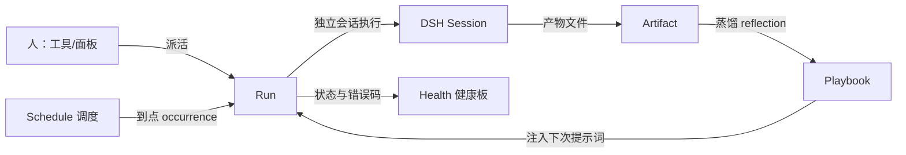

# 001 领域模型（Domain）

本文命名 dsh-super-agents 的全部概念，以及每个概念守住的规则。代码、工具、面板和后续文档
只用这些术语，不用别的。承接 [000 理念](000-philosophy.md)：模型只装工作需要的概念，
一个业务需求要么成为某概念的属性，要么成为一段提示词，不轻易加概念。

## 数据流

调度器（或人）产生 **Run**；一个 Run 拿到一个独立的 DSH 会话去执行；会话把交付物写进
**Artifact**；Run 结束后自动起一个 reflection Run，把这次执行蒸馏成 **Playbook** 条目，
下次派活时注入提示词——这就是自学习回路。**Health** 汇总需要人看的事实。

## 概念表

| 概念 | 定义 | 它守住的规则 | 为什么存在 |
| --- | --- | --- | --- |
| Agent（角色卡） | 一份持久化的 agent 配置：名字、系统人设、默认模型、工作目录、是否自学习、是否启用 | 配置即数据（JSON 台账），不是代码；停用不删除；删除时连带删掉它的调度 | 让"常驻 AI 员工"成为可增删改的数据，宿主重启不丢 |
| Schedule（调度） | Agent 的一条自主领活规则：cron / everySeconds / at 三选一 + 任务文本 + 可选 IANA 时区 | 一条规则只有一种触发方式；cron 按"时区内的分钟"去重，同一分钟只触发一次；`at` 触发一次后标记 firedAt；停用的规则不触发但保留 | 让 agent 不等人派活也能干活，且不重复触发 |
| Occurrence（触发次） | 一次调度命中：cron 是"时区墙钟分钟"，every 是"到点的时刻"，at 是"那个时刻" | 由 `(scheduleId, occurrence)` 派生出**确定性 id**；同 id 的 Run 只存在一个 | 崩溃重启、重复 tick 都不会重复派活 |
| Run（运行） | 一次执行：属于某个 Agent，带任务文本、工作目录、模型、产物路径、状态、错误码 | 创建即落盘（先持久化再执行）；状态只能单向推进；一个 Run 一个会话一个产物 | 审计单位、幂等单位、恢复单位 |
| Artifact（产物） | Run 唯一的正式交付物：一个 Markdown 文件 | 必须位于 Run 的 cwd 内（worker 沙箱只允许写自己 cwd）；第一行是一句话结论；没有产物 = `done_no_artifact`，不算成功 | 让"干完了"有可验证的凭据，而不是模型自说自话 |
| Playbook（经验册） | 每个 Agent 一份教训清单，注入其后续任务的提示词 | 只收 `- ` 开头的行；按行去重；有行数上限，超出丢最旧；`learn: false` 的 Agent 不注入不蒸馏 | 把一次执行的坑变成下次的默认动作 |
| Reflection（蒸馏运行） | 一种内部 Run：读上一次的任务与产物，产出可复用教训 | 不递归蒸馏；产物只当作教训文本消费；失败静默（不影响主 Run） | 自学习回路的执行体 |
| Health（健康条目） | 一个有名字、单一写者的健康事实（如 `scheduler`、`runner`、`sessionController`） | 每个条目只有一个写者；值只有 `ok / warn / error` + 一句可行动说明；`error` 才进面板顶部 | 把"系统是否需要人"变成可检查的事实，而不是翻日志 |
| Pause（暂停） | 全局开关：暂停调度触发（不杀正在跑的 Run） | 持久化；暂停期间调度器照常 tick 但不 fire；恢复后不补发暂停期间的 occurrence | 理念要求"agent 吵了就暂停它"，而不是加更多解释消息 |

## Run 状态与判定表

Run 的 `status` 是事实，不是意图。判定表从上往下读，第一行命中即止（借鉴原型的 stage 表）：

| status | 条件 | 面板标签 | 需要人吗 |
| --- | --- | --- | --- |
| `failed` | 执行抛错（含会话服务不可用、prompt 被拒） | 失败 | 是 |
| `timeout` | 超过 `runTimeoutMs` 未结束，已取消 | 超时 | 是 |
| `interrupted` | 宿主重启时该 Run 还在飞 | 已中断 | 是 |
| `cancelled` | 人主动取消（面板/`run-cancel`）：排队中立即生效，运行中先通知会话再由 runner 落终态 | 已取消 | 否 |
| `done_no_artifact` | 会话正常结束但没写产物文件 | 无产物 | 是（多半是产物路径/权限问题） |
| `done` | 会话结束且产物存在 | 完成 | 否 |
| `running` | 会话在跑 | 执行中 | 否 |
| `queued` | 已落盘未开跑 | 排队中 | 否 |

`queued` 的 Run 在宿主重启后会被**重新入队**（它从没开始过，重放是安全的）；
`running` 的 Run 只能标 `interrupted`——它的会话随旧进程一起没了，重放可能造成外部副作用。
`cancelled` 是终态：启动清扫只重放 `queued`，取消过的 Run 不会被重跑。

## 幂等 id

所有 id 由输入派生：`key(...values) = sha256(JSON.stringify(values)).slice(0,16)`。
等输入必等 id，于是天然去重：

- 调度触发的 Run：`key('run', scheduleId, occurrence)` —— 同一分钟重复 tick、崩溃后重放，都只会有一个 Run。
- 手动派活：`key('run', agentId, now, randomUUID())` —— 保留随机性（人确实可能同一秒派两次活）。

（原型的 `ids.ts` 用同一手法派生 ticket / assignment / input / ack / eval / decision 的 id，
这是它整条链路可重放的地基。）

## 被拒绝的概念（Rejected concepts）

与正面设计同等重要。以下都是"看起来很该做、我们决定不做"的东西，附理由：

| 诱人概念 | 为什么不做 |
| --- | --- |
| 多用户权限模型 / 允许名单 | 本项目跑在单个 DSH 宿主里，宿主已有会话与鉴权边界；再加一层名单只会增加设置项，不增加安全。要限制谁能用，限制谁能访问宿主。 |
| 事件源（GitHub / 飞书 / Webhook） | 原型的 Source 抽象很好，但那是"面向一个仓库的团队 agent"的需求。我们只做"人派活 + 定时领活"两条路。真要做，接口已按 SourceKind 的思路预留（见 [002 架构](002-architecture.md) 的扩展点）。 |
| SQLite 存储 | 我们的写入是低频小对象（角色卡、调度、Run 索引）。原子 JSON 文件 + 追加日志足够，且零依赖、可 grep、可手改。原型用 SQLite 是因为它有高频扇出与并发工作集查询。 |
| 从自由文本推断"在等人" | 原型明确把这条列为被拒概念。我们同样只信结构化状态：Run 需要人 = 状态码命中判定表，绝不从会话最后几句话猜。 |
| Agent 之间直接互发消息 | 会让注意力成本失控且不可审计。Agent 之间只通过 Run 产物与 Playbook 间接协作。 |
| 无限历史 | Run 索引只保留最近 300 条，日志/产物按文件留存由操作者清理。原型的"无界增长"被它自己列为已知债务，我们不等它爆。 |
| 每次运行都自动蒸馏 | 蒸馏要花一次模型调用。默认开（`learn: true`），但必须可关；且 reflection 失败绝不影响主 Run。 |
| 让 Run 的会话直接问人 | worker 会话无人值守。提问能力（`ask_user_question`、`present`）不属于它——需要人时它写产物 + 状态码，由人来看。 |
| 调度补发（catch-up） | 停机期间错过的 cron occurrence 不补发。补发会让"每天凌晨两点"变成"重启时来三次"，噪音远大于价值。 |

## 术语中英对照

| 中文 | 英文 | 一句话 |
| --- | --- | --- |
| 角色卡 | Agent | 一份持久化的 agent 配置 |
| 调度 | Schedule | 自主领活规则 |
| 触发次 | Occurrence | 一次调度命中 |
| 运行 | Run | 一次执行 |
| 产物 | Artifact | Run 唯一的正式交付物 |
| 经验册 | Playbook | 注入提示词的历史教训 |
| 蒸馏 | Reflection | 把一次执行提炼成教训 |
| 健康条目 | Health entry | 一个命名的、单一写者的健康事实 |
| 暂停 | Pause | 停止调度触发（不杀运行） |
